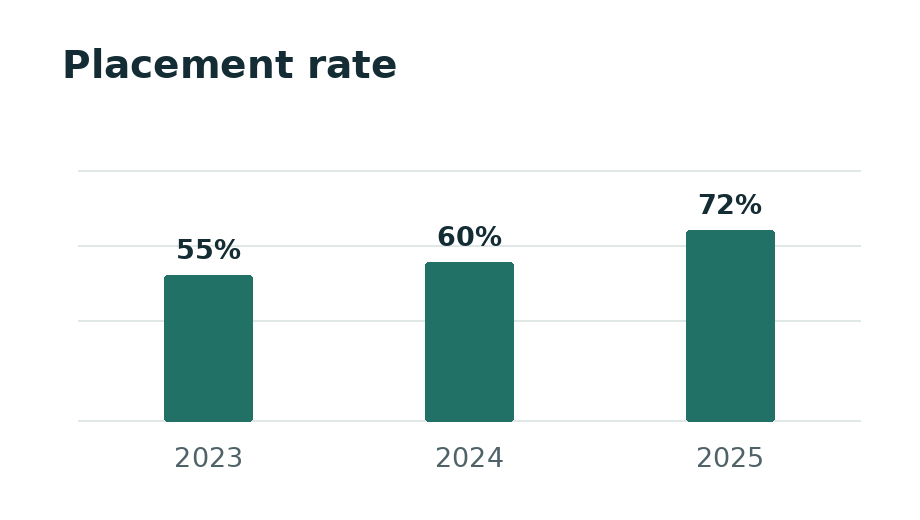

# ChartProof

ChartProof catches report sentences that have become inaccurate after a figure is revised. It links each claim to a metric, years, units and calculation. An author can reopen the audit, replace a figure, and see exactly which conclusion needs editing.

[Open the live workspace](https://chartproof-mu.vercel.app/) · [GitHub Actions checks](https://github.com/HuMaN-OG/ChartProof/actions/workflows/ci.yml) · [Download the source](https://github.com/HuMaN-OG/ChartProof/archive/refs/heads/main.zip)



## What is distinctive about ChartProof?

ChartProof is a **revision-aware evidence review tool**, not a general-purpose chart-question answering model. Its tested contribution is the complete workflow: record the original chart and numerical claim, preserve source hashes and reviewer confirmations, replace the chart, replay the same arithmetic claim against the new evidence, classify the transition and export a restorable audit. The **revision impact trace** lists changed, added and removed year/value pairs, distinguishes a source-file hash change from a change in the displayed numbers, and indicates whether the specific years a claim references changed. A reviewer can inspect the formula for each verdict rather than trust an opaque score.

**Novelty scope:** this is an implementation-level contribution combining known OCR, NLP classification, constrained comparison and versioned audit techniques. Existing research such as ChartCheck already studies chart claim verification; this project does **not** claim to invent chart fact-checking or achieve general-purpose chart understanding. The narrow parser recognizes a small set of English, single-series percentage comparisons, while manual reviewer linking supports a wider phrasing range. The Azure integrations are optional and are not evidence of a completed paid-cloud evaluation.

## Try the full workflow

1. Start the web app with Docker.

   ```sh
   docker build -t chartproof .
   docker run --rm -p 8000:8000 chartproof
   ```

2. Open **http://localhost:8000**. The two sample images run through Tesseract. The original shows a 12-point rise and the revision an 8-point rise. Open **Inspect evidence** to see the year/value revision impact and why “at least 10 percentage points” became inaccurate.
3. Load **Redesigned chart** or **Missing year** to see how the same check handles a cosmetic change or a missing reference year.
4. Use **Review / replace** to upload an image or a selected PDF page. Confirm the metric and values against the source. Add your sentence. For freer wording, use **Link a calculation** to confirm its interpretation. Automatic and reviewer-linked checks carry separate provenance.
5. **Export audit** saves a JSON file containing both previews, source hashes, original readings, reviewed values, claim bindings and results. **Open audit** replays the checks. The current workspace also persists in this browser's local storage.

## Native Python setup

Use Python 3.12, Tesseract 5 with the English language files, and a DejaVu Sans font for regenerating examples. Docker includes the native dependencies. On Windows, install Tesseract, add its installation directory to PATH, and use `py -3.12 -m venv .venv` and `.venv\Scripts\activate`.

```sh
python -m venv .venv
. .venv/bin/activate
python -m pip install -r requirements.txt
python app.py
```

The server reads HOST and PORT. Without configuration it binds to your own computer. App users need only a browser. Charts and checks live in the browser and are sent to the chosen server for processing. Clearing browser data clears the local workspace. The exported audit can restore it on a different computer.

## Supported inputs

Use an English single-series bar chart on one page, four-digit year labels, and explicit percentages from 0 to 100. The browser accepts a PNG, JPEG, WebP, or unlocked PDF up to 3 MiB. The native command line accepts files up to 6 MiB. Crop multi-figure pages before upload. The local engine pairs printed values to year labels by position. Review is required for every custom source. Check the percentage scale when using Azure.

| Operation | Example |
| --- | --- |
| Single-year lookup | Placement rate was at least 70% in 2025. |
| Percentage-point change | Placement rate rose by at least 10 percentage points from 2024 to 2025. |
| Relative percentage change | Placement rate grew by 20% from 2024 to 2025. |

The automatic English parser requires one supported comparison and the chart's metric name. A reviewer can bind a free-form sentence to the same three operations. Missing evidence, a zero relative-change denominator, or an unsupported automatic interpretation produces **Insufficient evidence**. Arithmetic uses the printed numbers with decimal precision. A statement about headcounts requires count data. Human-linked calculations express the reviewer's interpretation of the prose.

## Command line

```sh
python -m chartproof samples/original.pdf samples/corrected.png --claim "Placement rate rose by at least 10 percentage points from 2024 to 2025." --out audit.json
```

The command returns 0 for all supported revisions, 1 when any revision contradicts a claim, and 2 when any remaining result lacks evidence. The example returns 1. Open the exported audit in the web app to review the OCR fields.

## AI-901 implementation

| Component | Implementation |
| --- | --- |
| Document and visual information extraction | Azure Content Understanding analyzes the selected page image with `prebuilt-documentSearch`. The adapter normalizes a single Chart.js bar series. Local Tesseract is available independently. |
| Multimodal model and prompt design | A Microsoft Foundry vision deployment receives the same chart and claim and returns a verdict and rationale. It is a separate comparison in the web interface. |
| Language classification | A trained word and bigram TF-IDF logistic regression predicts lookup, point change, relative change, or unsupported. Versioned coefficients are served with Python's standard library. |
| Responsible AI | Source preview and file digest, preserved automatic readings, visible reviewer edits, evidence for verdicts, and explicit abstention. |

Read [Deployment and Azure setup](docs/deployment.md) for the Render Blueprint, required Azure permissions and variables, a two-call live smoke test and an optional live comparison. The recorded local results and offline Azure contract checks are in the [technical report](docs/technical-report.md).

## Reproduce the evaluation

```sh
python -m pip install -r requirements-dev.txt
python tools/train.py
python -m unittest discover -s tests -v
python tools/benchmark.py --out evaluation/local-run.json
```

The committed benchmark contains 180 revision verdicts across 12 controlled chart families. Inputs are rendered from known values and OCR reads the pixels. A separate 24-item language set, an external wording-coverage audit and a small CBSE check provide additional context. See [results](evaluation/results.json), [external coverage](evaluation/external-scope.json), and the [evaluation method and limitations](docs/technical-report.md).

## Repository layout

| Path | Purpose |
| --- | --- |
| `app.py`, `web/` | FastAPI service and browser workspace |
| `chartproof/` | Visual extraction, Azure clients, classifier and comparison logic |
| `samples/` | Original PDF and PNG figures and machine-readable sample references |
| `evaluation/`, `tools/` | Training examples, held-out cases, reference results and reproducible scripts |
| `tests/` | API, arithmetic, source-review, and cloud protocol regression checks |
| `Dockerfile`, `render.yaml`, `.github/workflows/` | Packaging, hosting configuration and continuous integration |

## Sources

[Microsoft AI-901 study guide](https://learn.microsoft.com/en-us/credentials/certifications/resources/study-guides/ai-901) · [Azure Content Understanding](https://learn.microsoft.com/en-us/azure/ai-services/content-understanding/document/elements) · [ChartCheck, ACL Findings 2024](https://aclanthology.org/2024.findings-acl.828/). Source attribution for the redrawn CBSE example is in the technical report.
